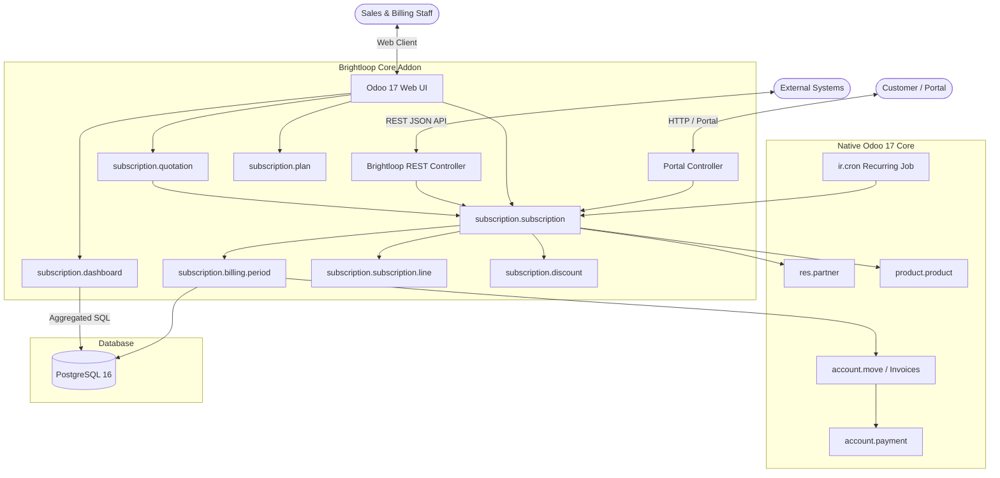
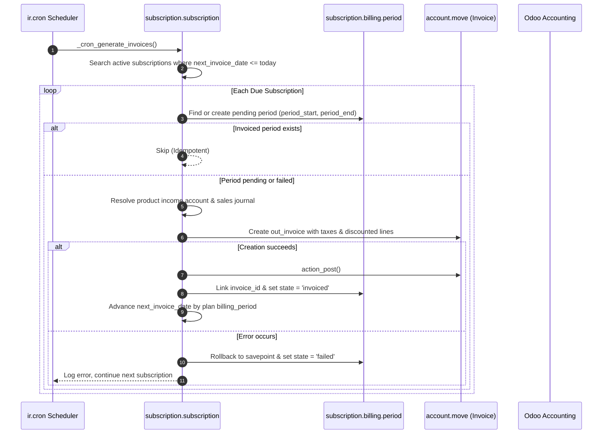

# Brightloop Architecture Documentation

## 1. System Overview

**Brightloop** is an enterprise-grade Subscription Management System built natively on **Odoo 17 Community Edition** and **PostgreSQL 16**. It is architected to handle recurring billing, product and plan management, subscription lifecycle transitions, quotation conversion, automated invoice creation, customer portal self-service, and executive financial reporting without external billing engines.

---

## 2. Key Architecture Pillars

### 2.1 Native Odoo 17 Integration
- Extends standard Odoo models (`res.partner`, `res.users`, `product.template`, `product.product`, `account.move`).
- Adheres strictly to Odoo 17 Community patterns: `tree` root elements, Python expression-based `invisible` modifiers, `env.company` multi-company scoping, and transactional ORM methods.

### 2.2 Idempotency & The Billing Period Engine
- Every billing iteration is tracked by `subscription.billing.period`.
- The compound SQL constraint `unique(subscription_id, period_start, period_end)` forms the **idempotency boundary**.
- Even if a cron job runs repeatedly or concurrently, duplicate invoices can never be generated for the same subscription period.
- Transient errors mark the period as `failed` without advancing `next_invoice_date`, allowing seamless retries without data corruption.

### 2.3 Quotation-to-Subscription Conversion
- Quotations can be built manually or instantly populated from reusable `subscription.quotation.template` presets.
- When an administrator or customer accepts the quotation, `action_convert_to_subscription()` instantiates the confirmed `subscription.subscription` with exact lines, prices, and plan parameters.

### 2.4 Customer Self-Service Portal
- Portal users (`base.group_portal`) access their own subscriptions at `/my/brightloop/subscriptions`.
- Clean detail view displays line items, pricing totals, billing period audit trails, and linked invoices.
- Customers can pause, resume, cancel, or renew subscriptions directly from the UI, subject to the plan's policy permissions (`allow_pause`, `allow_cancel`, `allow_renewal`).

### 2.5 High-Performance Executive Dashboard
- The dashboard calculates MRR, ARR, active counts, receivables, and cash flow via direct, indexed PostgreSQL queries (`SUM`, `COUNT`, `GROUP BY`).
- Achieves sub-50ms execution times even with large databases (>100,000 subscriptions and invoices).

---

## 3. Data Flow & Billing Engine Lifecycle

---

## 4. Multi-Company & Security Architecture

1. **Company Isolation:** Record rules enforce `('company_id', 'in', company_ids)` on subscriptions, quotations, plans, and discounts.
2. **Customer Portal Isolation:** Portal users are restricted strictly by `[('partner_id', '=', user.partner_id.id)]` across subscriptions, quotations, lines, and billing history.
3. **Password Security:** Model constraints on `res.users` enforce enterprise complexity: minimum 8 characters, at least 1 uppercase letter, 1 lowercase letter, and 1 special symbol.
4. **Unique Partner Identifiers:** Unique email constraint ensures customer records cannot be duplicated.
