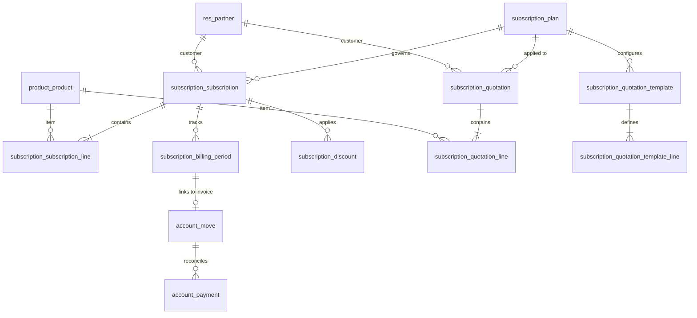

# Brightloop Database Schema & Relational Model

## 1. Relational Entity Overview

---

## 2. Model Specifications

### 2.1 `subscription.plan`
Configures billing frequency, minimum commitments, pricing tiers, and customer lifecycle privileges.

| Column | Type | Constraints | Description |
|---|---|---|---|
| `id` | integer | PK | Auto-increment primary key |
| `name` | varchar | NOT NULL | Plan name (e.g., Cloud Pro, Enterprise) |
| `product_id` | integer | FK -> `product.product`, NOT NULL | Primary subscription service item |
| `price` | numeric | NOT NULL | Recurring plan price per billing cycle |
| `billing_period` | varchar | NOT NULL | `daily`, `weekly`, `monthly`, `yearly` |
| `minimum_quantity` | integer | default 1 | Minimum unit order required |
| `allow_pause` | boolean | default true | Allows customer or staff to pause |
| `allow_early_close` | boolean | default false | Allows customer or staff to close early |
| `allow_renewal` | boolean | default true | Allows renewal upon expiration |
| `allow_cancel` | boolean | default true | Allows cancellation |
| `auto_close` | boolean | default false | Closes automatically when end date is reached |
| `company_id` | integer | FK -> `res.company` | Scoping company |

### 2.2 `subscription.subscription`
Core subscription record managing state, pricing subtotals, tax aggregates, and invoice schedules.

| Column | Type | Constraints | Description |
|---|---|---|---|
| `id` | integer | PK | Auto-increment primary key |
| `name` | varchar | NOT NULL | Auto-generated number (`BL/SUB/YYYY/NNNNN`) |
| `partner_id` | integer | FK -> `res.partner`, NOT NULL | Customer |
| `plan_id` | integer | FK -> `subscription.plan`, NOT NULL | Billing plan |
| `company_id` | integer | FK -> `res.company`, NOT NULL | Legal company entity |
| `currency_id` | integer | FK -> `res.currency`, NOT NULL | Transaction currency |
| `start_date` | date | NOT NULL | Subscription start date |
| `end_date` | date | NULLABLE | Subscription expiration date |
| `next_invoice_date` | date | INDEX | Next scheduled invoice date |
| `state` | varchar | NOT NULL | `draft`, `quotation`, `confirmed`, `active`, `paused`, `closed`, `cancelled` |
| `amount_untaxed` | numeric | computed | Net subtotal after eligible discounts |
| `amount_tax` | numeric | computed | Total calculated taxes |
| `amount_total` | numeric | computed, STORED | Gross total recurring amount |

**Unique Constraints:**
- `unique(name, company_id)`: Guarantees unique subscription numbering across company entities.

### 2.3 `subscription.subscription.line`
Line-level products, quantities, custom pricing, and taxes.

| Column | Type | Constraints | Description |
|---|---|---|---|
| `id` | integer | PK | Auto-increment primary key |
| `subscription_id` | integer | FK -> `subscription.subscription`, NOT NULL | Parent subscription |
| `product_id` | integer | FK -> `product.product`, NOT NULL | Product or variant |
| `name` | text | NOT NULL | Line description |
| `quantity` | numeric | NOT NULL, default 1.0 | Subscribed units |
| `price_unit` | numeric | NOT NULL | Unit price (includes variant extra price) |
| `discount` | numeric | default 0.0 | Line percentage discount |
| `subtotal` | numeric | computed | `quantity * price_unit * (1 - discount/100)` |

### 2.4 `subscription.billing.period`
The core transactional ledger that establishes billing idempotency and links subscriptions to posted invoices.

| Column | Type | Constraints | Description |
|---|---|---|---|
| `id` | integer | PK | Auto-increment primary key |
| `subscription_id` | integer | FK -> `subscription.subscription`, NOT NULL | Related subscription |
| `period_start` | date | NOT NULL | Billing cycle start date |
| `period_end` | date | NOT NULL | Billing cycle end date |
| `invoice_id` | integer | FK -> `account.move`, NULLABLE | Linked customer invoice |
| `state` | varchar | NOT NULL | `pending`, `invoiced`, `failed` |

**Compound Idempotency Constraint:**
- `unique(subscription_id, period_start, period_end)`: Strictly prevents duplicate invoices for the same subscription period.

### 2.5 `subscription.discount`
Rule-based promotion engine supporting fixed-amount and percentage discounts.

| Column | Type | Constraints | Description |
|---|---|---|---|
| `id` | integer | PK | Auto-increment primary key |
| `name` | varchar | NOT NULL | Promo code / description |
| `discount_type` | varchar | NOT NULL | `percentage` or `fixed` |
| `discount_value` | numeric | NOT NULL | Amount or percentage value |
| `min_amount` | numeric | default 0.0 | Minimum subtotal required |
| `min_quantity` | numeric | default 0.0 | Minimum total quantity required |
| `start_date` | date | NULLABLE | Promo validity start |
| `end_date` | date | NULLABLE | Promo validity end |
| `max_usage` | integer | default 0 | Maximum redemptions allowed (0 = unlimited) |
| `usage_count` | integer | default 0 | Current redemption count |

### 2.6 `subscription.quotation` & `subscription.quotation.template`
Sales quotation management allowing template pre-configuration and conversion into active subscriptions upon customer or sales approval.
