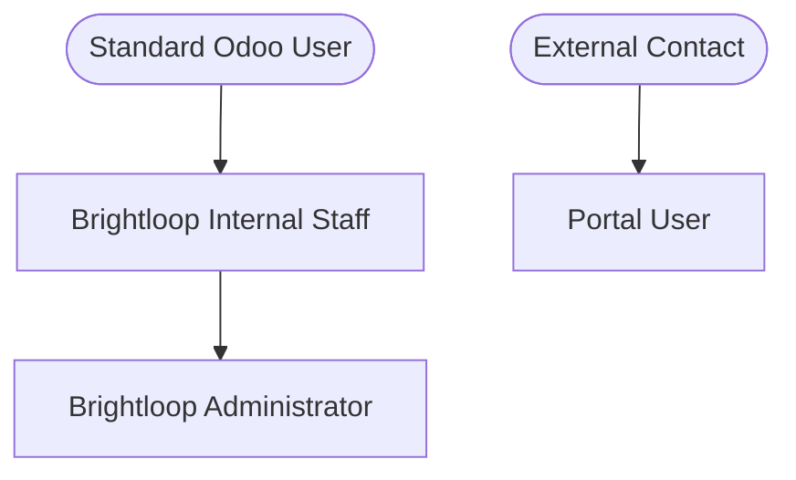

# Brightloop Security & Access Control Architecture

## 1. Security Groups

Brightloop implements role-based access control (RBAC) mapped to standard Odoo security mechanisms:

### 1.1 Groups Overview
1. **`brightloop_subscription.group_brightloop_staff` (Brightloop Internal Staff)**
   - Inherits `base.group_user`.
   - Access to Plans, Subscriptions, Quotation Templates, Quotations, and Dashboard.
   - Read, Write, and Create permissions on business transactions.
   - `perm_unlink=0` (record deletion is disabled to prevent accidental audit loss).
2. **`brightloop_subscription.group_brightloop_admin` (Brightloop Administrator)**
   - Inherits `group_brightloop_staff`.
   - Full CRUD permissions across all models.
   - Exclusive maintenance permissions for `subscription.discount` promotional rules.
   - Automatically assigned to `base.user_root` and `base.user_admin`.
3. **`base.group_portal` (External Customer Portal)**
   - Read-only access to customer's own subscriptions, quotations, lines, and billing history.
   - State transition actions (pause, resume, cancel, renew) are invoked via secured controller endpoints that authenticate the user, verify partner ownership, validate plan policy flags, and execute via server-side elevation (`sudo()`).

---

## 2. Multi-Company Isolation

All major models enforce strict multi-company record rules ensuring users in Company A cannot view or manipulate records belonging to Company B:

| Rule Name | Model | Domain Filter |
|---|---|---|
| `rule_subscription_staff_company` | `subscription.subscription` | `[('company_id', 'in', company_ids)]` |
| `rule_quotation_staff_company` | `subscription.quotation` | `[('company_id', 'in', company_ids)]` |
| `rule_plan_staff_company` | `subscription.plan` | `['\|', ('company_id', '=', False), ('company_id', 'in', company_ids)]` |
| `rule_discount_staff_company` | `subscription.discount` | `['\|', ('company_id', '=', False), ('company_id', 'in', company_ids)]` |

---

## 3. Customer Portal Isolation

Portal customers are restricted strictly to their own data via dedicated record rules:

| Rule Name | Model | Domain Filter |
|---|---|---|
| `rule_subscription_portal_own` | `subscription.subscription` | `[('partner_id', '=', user.partner_id.id)]` |
| `rule_quotation_portal_own` | `subscription.quotation` | `[('partner_id', '=', user.partner_id.id)]` |
| `rule_billing_period_portal_own` | `subscription.billing.period` | `[('subscription_id.partner_id', '=', user.partner_id.id)]` |
| `rule_subscription_line_portal_own` | `subscription.subscription.line` | `[('subscription_id.partner_id', '=', user.partner_id.id)]` |
| `rule_quotation_line_portal_own` | `subscription.quotation.line` | `[('quotation_id.partner_id', '=', user.partner_id.id)]` |

---

## 4. Authentication & Data Protection

1. **Password Complexity:**
   - Implemented via `@api.constrains('password')` on `res.users`.
   - Rejects passwords shorter than 8 characters, or those lacking an uppercase letter, lowercase letter, and special symbol (`!@#$%^&*()_+-=[]{}|;:,.<>?`).
2. **Unique Customer Email:**
   - Implemented via `@api.constrains('email')` on `res.partner`.
   - Rejects duplicate email addresses among customers (`customer_rank > 0`).
3. **Billing Transaction Savepoints:**
   - `_generate_invoice()` runs within PostgreSQL transaction savepoints (`self.env.cr.savepoint()`).
   - If an error occurs during invoice creation or posting, the sub-transaction is rolled back cleanly, marking `subscription.billing.period` as `failed` without corrupting accounting ledgers.
